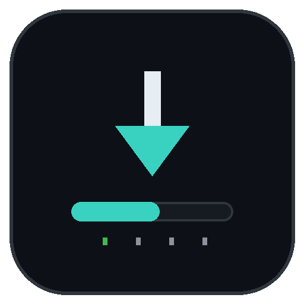

<p align="center">
  
</p>

# Remote PKG Installer NextGen

[](https://github.com/AldySan/ps4_remote_pkg_installer_nextgen/actions/workflows/build.yml)
[](https://github.com/AldySan/ps4_remote_pkg_installer_nextgen/releases)
[](https://github.com/AldySan/ps4_remote_pkg_installer_nextgen)
[](LICENSE)

Remote PKG Installer NextGen installs PKG files on a jailbroken PS4 over
your home network. Send an install from a PC, a phone, or any script, and
watch it happen live on your TV. No USB drives, no copying files back and
forth.

It is a modern rewrite of flatz's
[ps4_remote_pkg_installer](https://github.com/flatz/ps4_remote_pkg_installer),
built with the [OpenOrbis PS4 Toolchain](https://github.com/OpenOrbis/OpenOrbis-PS4-Toolchain),
and it keeps the original API intact, so tools that worked with the old
app keep working here.

## Highlights

- Live dashboard on your TV: every transfer with speed, progress, and ETA,
  plus free storage space and the console's IP address
- Full pkg info on every card: icon, title, version, content id, type, and
  size
- Per-item controls from the controller: pause, resume, stop, or
  re-transfer any item
- Works with or without a network: the app never crashes or exits when
  there is no link, and the server starts on its own once one appears
- Faster transfers: split pkg pieces are fetched through up to 4 parallel
  connections when the source server allows it
- Legacy API kept 1:1: existing frontends, tools, and scripts work without
  changes
- New v2 API: a cleaner REST interface with job management, progress, and
  logs

## Requirements

- A PS4 with HEN active (or any kernel payload that provides fPKG support
  and a `/data` mount), same as the original application
- A device on the same network to send the install from: a PC, a phone,
  anything that can make an HTTP request

## Installation

### Option 1: download a release

Go to the [releases page](https://github.com/AldySan/ps4_remote_pkg_installer_nextgen/releases)
and grab the latest `RemotePkgInstallerNextGen-x.y.z.pkg`. Every release
ships with a ready-to-install package built by CI.

### Option 2: build from source

You will need the
[OpenOrbis PS4 Toolchain](https://github.com/OpenOrbis/OpenOrbis-PS4-Toolchain)
(set the `OO_PS4_TOOLCHAIN` environment variable), plus `clang`, `lld`,
and `python3`:

```sh
export OO_PS4_TOOLCHAIN=/path/to/OpenOrbis/PS4Toolchain
make
```

The final package is `IV0000-RPIN00001_00-RPINEXTGEN000000.pkg`.

Either way, install the resulting pkg on your PS4 with HEN active, using
your usual package installer, and launch it from the home screen.

## Usage

1. Launch the app. The dashboard shows the console's IP address, free
   storage, and your transfers.
2. From any device on the same network, send an install. The pkg needs to
   be reachable over HTTP, for example from a simple web server on your PC.
3. Watch the progress on screen, or control transfers with the controller:

| Button | Action |
|---|---|
| D-pad up/down | Select transfer |
| X (cross) | Pause / resume the selected transfer |
| O (circle) | Stop the selected transfer |
| [ ] (square) | Re-transfer (re-run a completed, failed, or stopped transfer) |
| ▲ (triangle) | Expand full pkg details (icon, version, title id, source URL) |
| OPTIONS | Exit |

Transfers run through the system's BGFT download manager, so they keep
going even after you close the app.

### Quick start (from a PC)

```sh
# Check the server
curl http://<PS4-IP>:12800/api/v2/system

# Install a package (URL served by any web server on your network)
curl -v 'http://<PS4-IP>:12800/api/install' \
  --data '{"type":"direct","packages":["http://<PC-IP>:8080/UP0001-CUSA09311_00-GAME.pkg"]}'

# Watch progress (speed, percent, ETA)
curl 'http://<PS4-IP>:12800/api/v2/jobs'

# Pause / resume / stop a job
curl 'http://<PS4-IP>:12800/api/v2/jobs/1/pause' -X POST
curl 'http://<PS4-IP>:12800/api/v2/jobs/1/resume' -X POST
curl 'http://<PS4-IP>:12800/api/v2/jobs/1/stop' -X POST
```

The full API reference (legacy and v2) lives in
[docs/API.md](docs/API.md).

### Changing the port

The server listens on port **12800** by default. To use a different one,
change `APP_DEFAULT_PORT` in [src/version.h](src/version.h) and rebuild.

## Development

Host unit tests cover the portable core (util, SFO, and pkg parsing) and
run on your machine, no PS4 needed:

```sh
make test
```

Fixtures in `tests/data/` are generated from a real build: `param.sfo`
and the first 0x3000 bytes of a real package header.

The dashboard renders with a generated bitmap font and generated splash
assets. Regenerate them with:

```sh
python3 tools/gen_font.py    # embedded font (requires Pillow)
python3 tools/gen_assets.py  # icon and splash screens (requires Pillow)
```

Project layout:

```
src/               application code (C11, no framework)
thirdparty/        vendored cJSON + dbglogger (MIT), custom libSceBgft stub
tools/             asset/font generators, host unit tests
tests/data/        unit test fixtures
docs/API.md        HTTP API reference (legacy + v2)
DESIGN.md          design direction and palette for the dashboard
```

Every pull request into `dev` and every push to `main` is built by CI,
and each release pkg is attached to its GitHub release automatically.

## Technology

- Plain C11 and one Makefile, no framework
- SDL2 (OpenOrbis port) for the dashboard
- [cJSON](https://github.com/DaveGamble/cJSON) and
  [dbglogger](https://github.com/bucanero/dbglogger) as vendored libraries
- Python with Pillow for the font and asset generators
- GitHub Actions for CI and releases

## Contributing

Issues and pull requests are welcome. If you want to help with code,
docs, or testing, [CONTRIBUTING.md](CONTRIBUTING.md) explains the setup
and the workflow, and it is written with first-time contributors in mind.
By participating, you agree to uphold our [Code of Conduct](CODE_OF_CONDUCT.md).

## Support development

Remote PKG Installer NextGen is a free, open-source hobby project. If it
made your life easier, here are a few ways to support it:

- Give the repository a ⭐ Star on
  [GitHub](https://github.com/AldySan/ps4_remote_pkg_installer_nextgen).
  It helps other PS4 owners find the project.
- Share it with friends or communities that still install pkgs the slow
  way.
- Support development on Ko-fi:
  [ko-fi.com/aldysan](https://ko-fi.com/aldysan).

Every star, share, and coffee is appreciated, but nothing is expected.
The app is free and open source under GPL-3.0, and it stays that way.

## Credits

- flatz: the original [Remote Package Installer](https://github.com/flatz/ps4_remote_pkg_installer)
- OpenOrbis Team: the OpenOrbis PS4 Toolchain and the SDL2 port
- DaveGamble: [cJSON](https://github.com/DaveGamble/cJSON) (MIT)
- bucanero: [dbglogger](https://github.com/bucanero/dbglogger) (MIT)

## License

GPL-3.0, see [LICENSE](LICENSE).
